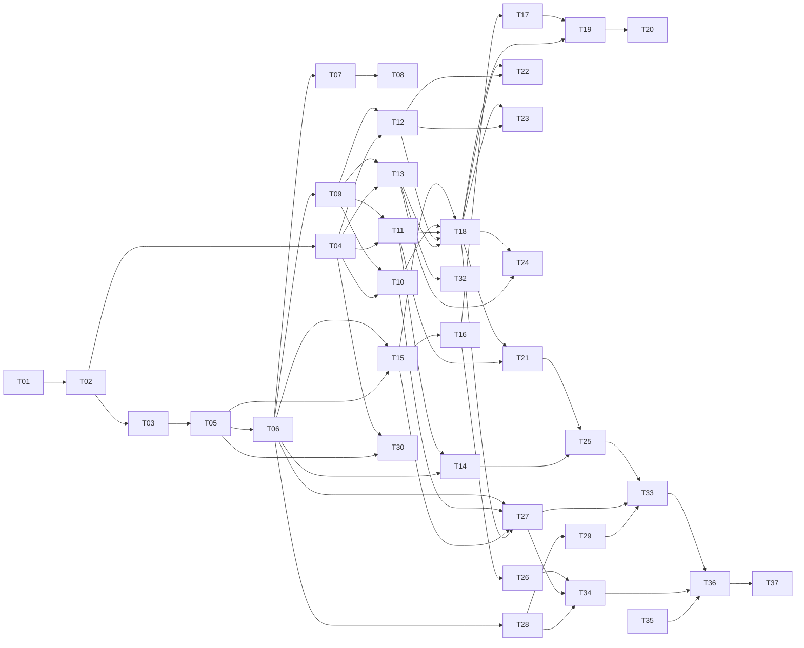

# Task backlog

37 tasks across 5 milestones to bring the portfolio to the system described in `REFERENCE-ANALYSIS.md`.
Each task has its own file in [`tasks/`](tasks/). Sizes are **relative estimates** (S ≲ ½ day · M ≈ 1 day · L ≈ 2–3 days · XL > 3 days), not commitments.

**Status:** `[ ]` pending · `[~]` in progress · `[x]` done. Update it here when you finish.

## How to work

1. Pick a task whose dependencies are all `[x]`.
2. Read its file and the docs cited under **Reading**.
3. Follow the workflow and the *Definition of Done* in the [`CLAUDE.md` Workflow section](../../CLAUDE.md#workflow).
4. Tasks marked ⚑ **need content from the owner** (see [`CONTENT.md`](CONTENT.md)); without it the code uses `TODO(content)` placeholders.

## Milestones

| Milestone | Outcome | Tasks | Shippable? |
|---|---|---|---|
| **M1 — Shell without 3D** | Complete new site in 2D: HUD, smooth scroll, reveals, sections, case files. **It is also the `no-webgl` fallback** | T01–T14 | ✅ yes |
| **M2 — 3D vertical slice** | World loads on demand; camera flies between *home* and *about*; adaptive quality | T15–T20 | ✅ yes (partial world) |
| **M3 — Full world** | Clickable 3D projects, skills constellation, journey helix, contact portal, bloom | T21–T26 | ✅ yes |
| **M4 — Intro and sound** | Cinematic fly-in and procedural spatial audio | T27–T29 | ✅ yes |
| **M5 — Release** | SEO/PWA, assets, hardened API, a11y, performance, tests/CI, cleanup, deploy | T30–T37 | ✅ release |

> T30, T31 and T32 do not depend on 3D: they can run in parallel already during M1.

## Phase 0 — Foundation (M1)

- [x] [T01 — Baseline: lint, `lang` and dependencies in sync](tasks/T01-baseline-lint-and-lang.md) · S · —
- [x] [T02 — Dependencies, aliases and folder structure](tasks/T02-dependencies-and-structure.md) · S · T01
- [x] [T03 — Design tokens, fonts and global styles](tasks/T03-design-tokens-fonts-global-styles.md) · M · T02
- [x] [T04 — Content model and i18n](tasks/T04-content-model-and-i18n.md) ⚑ · M · T02

## Phase 1 — Shell and scroll (M1)

- [x] [T05 — Root layout and shell slots](tasks/T05-root-layout-and-shell-slots.md) · M · T03
- [x] [T06 — ScrollProvider (Lenis + GSAP + ScrollTrigger)](tasks/T06-scroll-provider-lenis-gsap.md) · M · T02, T05
- [x] [T07 — HUD: top bar, nav rail and mobile menu](tasks/T07-hud-nav-rail-and-mobile-menu.md) · M · T04, T05, T06
- [x] [T08 — Locator and active section](tasks/T08-locator-and-active-section.md) · S · T07
- [x] [T09 — Reveal system](tasks/T09-reveal-system.md) · S · T06
- [x] [T10 — Home and About sections](tasks/T10-section-home-about.md) ⚑ · M · T03, T04, T09
- [x] [T11 — Work section and archive](tasks/T11-section-work-and-archive.md) ⚑ · M · T03, T04, T09
- [x] [T12 — Skills and Journey sections](tasks/T12-section-skills-and-journey.md) ⚑ · M · T03, T04, T09
- [x] [T13 — Contact section and Footer](tasks/T13-section-contact-and-footer.md) · M · T03, T04, T09
- [x] [T14 — Case files (`<dialog>`)](tasks/T14-case-file-dialog.md) ⚑ · M · T06, T11

## Phase 2 — 3D world (M2 and M3)

- [x] [T15 — World engine skeleton](tasks/T15-world-engine-skeleton.md) · L · T02, T05, T06
- [x] [T16 — Adaptive quality and sliced boot](tasks/T16-quality-manager-and-boot-slices.md) · M · T15
- [x] [T17 — Environment: sky, stars, lighting and mood](tasks/T17-environment-sky-lights-mood.md) · M · T15, T16
- [x] [T18 — Camera rig and stations](tasks/T18-camera-rig-and-stations.md) · L · T15, T10–T13
- [x] [T19 — Home scene: central star and rings](tasks/T19-scene-home-star-and-rings.md) · M · T17, T18
- [x] [T20 — About scene: lens](tasks/T20-scene-about-lens.md) · M · T19
- [x] [T21 — Work scene: project artifacts](tasks/T21-scene-work-artifacts.md) ⚑ · XL · T11, T18
- [x] [T22 — Skills scene: constellation](tasks/T22-scene-skills-constellation.md) · L · T12, T18
- [x] [T23 — Journey scene: helix and comet](tasks/T23-scene-journey-helix.md) · M · T12, T18
- [x] [T24 — Contact scene: portal](tasks/T24-scene-contact-portal.md) · M · T13, T18
- [x] [T25 — Picking and hover](tasks/T25-picking-and-hover.md) · M · T14, T21
- [x] [T26 — Post-processing: bloom](tasks/T26-postprocessing-bloom.md) · S · T16

## Phase 3 — Intro and sound (M4)

- [x] [T27 — Intro sequence](tasks/T27-intro-sequence.md) · L · T06, T10, T15, T18
- [x] [T28 — Procedural audio engine](tasks/T28-sound-engine.md) · L · T06
- [x] [T29 — Sound UI](tasks/T29-sound-ui.md) · M · T28, T05

## Phase 4 — Release (M5)

- [ ] [T30 — SEO, PWA and structured data](tasks/T30-seo-pwa-jsonld.md) ⚑ · M · T04, T05
- [ ] [T31 — Asset optimization](tasks/T31-asset-optimization.md) ⚑ · M · T04
- [ ] [T32 — Harden the contact API](tasks/T32-harden-contact-api.md) · M · T13
- [ ] [T33 — Accessibility and reduced-motion audit](tasks/T33-accessibility-and-reduced-motion-audit.md) · L · T25, T27, T29
- [ ] [T34 — Performance budget and leak audit](tasks/T34-performance-budget-and-leak-audit.md) · L · T26, T27, T28
- [ ] [T35 — Tests and CI](tasks/T35-tests-and-ci.md) · L · T16 (grows until the end)
- [ ] [T36 — Legacy cleanup and final docs](tasks/T36-legacy-cleanup-and-docs.md) · M · all features
- [ ] [T37 — Deploy and rollout](tasks/T37-deploy-and-rollout.md) · S · T36

## Dependencies (critical path in bold)

Critical path: **T01 → T02 → T03 → T05 → T06 → T09 → T10–T13 → T18 → T21 → T25 → T33 → T36 → T37**. T27/T29 (intro, sound UI) and T34 (performance) run alongside it and also gate T33/T36.

## Traceability: feature → task

| Feature | Task(s) | Feature | Task(s) | Feature | Task(s) |
|---|---|---|---|---|---|
| F01 Skip link | T05 | F14 Quality | T16 | F27 Emitters | T28 |
| F02 Top HUD | T07 | F15 Boot | T16 | F28 UI sounds | T28 |
| F03 Nav rail | T07 | F16 Loop/dispose | T15, T34 | F29 Sound panel | T29 |
| F04 Locator | T08 | F17 Environment | T17 | F30 Sections | T10–T13 |
| F05 Anchors | T07 | F18 Home scene | T19 | F31 Case files | T14 |
| F06 Footer | T13 | F19 About scene | T20 | F32 Archive | T11 |
| F07 Smooth scroll | T06 | F20 Work scene | T21 | F33 A11y | T03, T33 |
| F08 Layout refresh | T06 | F21 Skills scene | T22 | F34 No WebGL | T15 |
| F09 Reveal | T09 | F22 Journey scene | T23 | F35 Responsive | T03, T33 |
| F10 Intro | T05, T27 | F23 Contact scene | T24 | F36 SEO/PWA | T30 |
| F11 Canvas/background | T05, T15 | F24 Picking | T25 | F37 Fonts/images | T03, T31 |
| F12 Renderer/camera | T15 | F25 Bloom | T26 | | |
| F13 Rig | T18 | F26 Audio engine | T28 | | |
